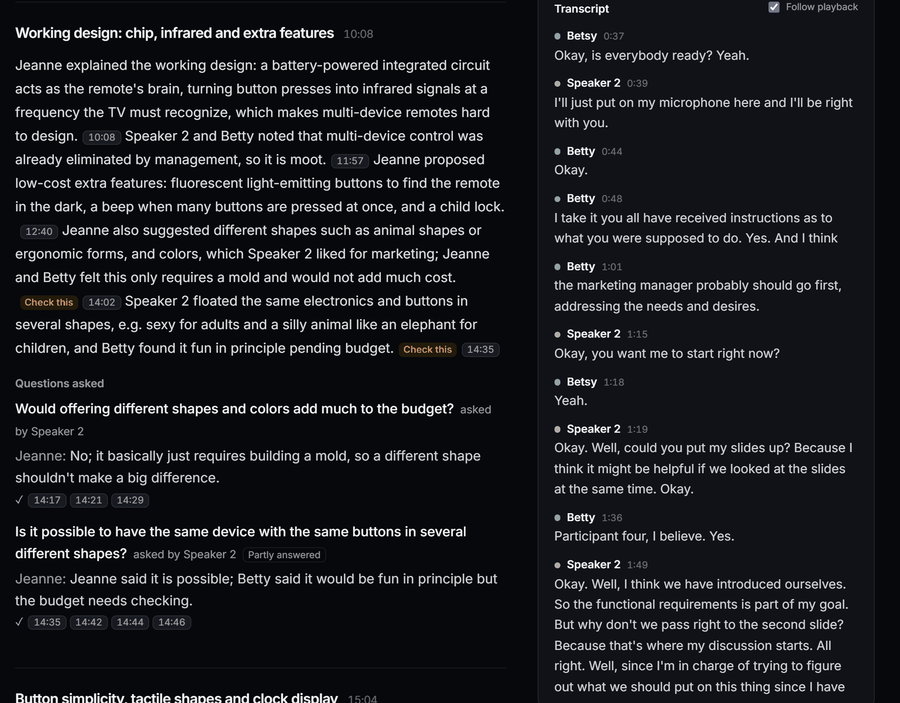
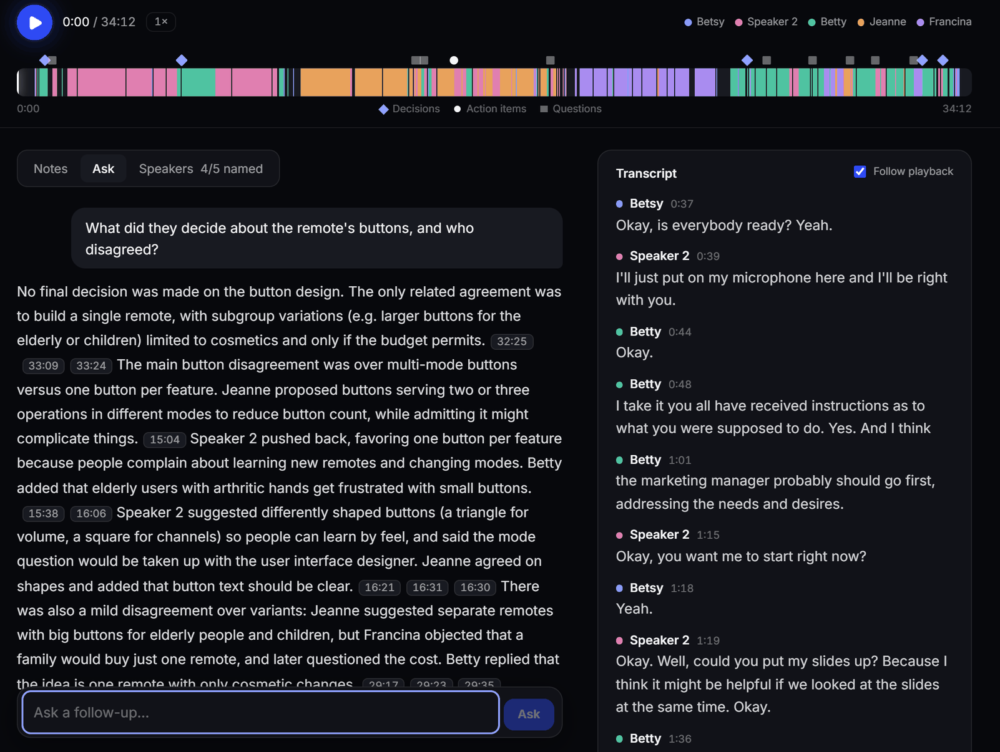

# Notetaker

[](https://github.com/monu4959/AI-note-taker/actions/workflows/ci.yml)

Record a Zoom or Teams call on your computer (or upload a recording) and get a
speaker-labelled transcript and notes organised by topic: what was discussed, what was decided,
the questions asked (with who answered and what they said), then action items and what is still
open. Every note cites the lines it came from, is checked against them before it is shown, and
plays that moment of the audio when clicked.

**Demo (4:44)**: uploading a 64-minute Zoom call, the notes, asking it questions, then recording
a call live.

https://github.com/user-attachments/assets/f4103108-3ec1-4a7c-a707-26a7b914163e

**Ask the meeting:** each meeting has an Ask tab for questions the notes don't cover ("what did
we say the budget was?", "who is doing the LinkedIn part?"). Answers come only from that
meeting, cite their lines, and say so when something wasn't discussed (`pipeline/ask.py`).

| Notes by topic, with the questions asked | Ask the meeting |
|---|---|
|  |  |

Speakers get real names: from voices you chose to remember (recognised in later meetings) or
from introductions in the transcript, which you confirm. Unclear speakers stay unnamed.

Recording works like Granola: no bot joins the call. The app records your microphone and
everything the computer plays, notices when Zoom or Teams is in a call (and when it ends), and
labels you from your own mic. Works with or without headphones.

**Notes model:** `NOTES_LLM` in `.env`. `claude` (current) = Opus 5.5 writes, Sonnet 5.5 checks
and answers questions (the results below), with a spend cap per budget scope (`LLM_BUDGET_USD`);
`local` = Qwen 2.5 7B through Ollama on the server, free, Claude blocked in code. Restart after
switching: `reports/step4.md`. All release gates: `.venv/Scripts/python scripts/gates.py`.

Status: recording, upload and speaker names work end to end. Live captions during the call
were replaced by the recorder (`docs/adr/0001-desktop-recorder-instead-of-live-captions.md`).
Design: `Meeting-Intelligence-Pipeline-Design.pdf`.

## Results (AMI Meeting Corpus, test split)

| What | Metric | Result | Data |
|---|---|---|---|
| Speaker diarization | DER (no collar, overlap scored) | **17.05%** (published: 17.0%) | 16 meetings, 9.1 h |
| Transcription | WER, speaker-agnostic (ORC-WER) | 25.8% (80% of errors are deletions) | 5 meetings |
| Who said what | cpWER | 29.4% | 5 meetings |
| Speaker names by voice | precision / share named, enroll from meeting a, test on b–d | **100% (69/69)** / 92% | 6 AMI series, 18 meetings |
| Strangers | never-enrolled people given a name | **0 of 75** | same |
| Names from the transcript | right person, where the human transcript can check | 94% (16/17) | 24 meetings |
| Decisions captured | recall vs AMI human summary, strict / incl. partial | **72.6% / 98.4%** | 12 meetings, 62 decisions |
| Action items captured | recall, strict / incl. partial | 70.0% / 85.0% | 20 actions |
| Problems captured | recall, strict / incl. partial | 71.0% / 100% | 31 problems |
| Grounding | citations overlapping the human-linked evidence | **70.9%** | 220 pairs |
| Numbers | metrics whose value isn't in the human transcript | **2.6%** (0% on human transcripts) | 114 metrics |
| Recording on this computer | WER vs uploading the same meeting, with / without headphones | **worst +1.7 points** (gate: 2) | 8 recordings of a 39 min meeting |
| Who is "you" | the person recording, named from their mic | **8 of 8** correct | same |
| Speed | 1-hour meeting, RTX 4060 laptop (8 GB) | ~4 min (recording: notes 5 min after Stop for 39 min) | |
| Cost | Claude Opus 5.5 extraction + Sonnet 5.5 verification | ~$0.55 per meeting hour | |
| Cost, Ask | Sonnet 5.5 reads the whole meeting, prompt-cached | ~$0.045 first question, ~$0.004 follow-ups (1 h meeting) | |
| Cost, local notes (Qwen 2.5 7B) | notes written on the server's GPU | $0; ~12 min per meeting hour | quality not yet graded (reports/step4.md) |

The notes rows were measured with notes prompt v2 (decisions, actions, problems, numbers),
before the current v3 layout by topic with Q&A; v3 has not been re-scored yet. Prompts were tuned on 3 AMI dev meetings and frozen before the test run. Repeating a run moves
scores by 5–12 points on 3 meetings, so small differences are noise. Precision against AMI is
only a lower bound (its summaries are incomplete); hand-labelled precision is in
`reports/step1.md`. Details: `reports/step0.md`, `reports/step1.md`, `reports/step2.md`, `reports/step3.md`.

## How it works

```
record ─► mic + loopback of every output, 16 kHz, clock-locked   services/recorder.py
        ─► echo removal, mix, levels (who is you)                pipeline/recording.py
upload ─► prepare (any format → 16 kHz mono, loudness)    pipeline/audio.py
        ─► transcribe (faster-whisper large-v3, batched)   pipeline/asr.py
        ─► diarize (pyannote community-1)                  pipeline/diarization.py
        ─► words → speakers → utterances u0000…            pipeline/assign.py
        ─► names: transcript cues (LLM + checks)           pipeline/name_cues.py
        ─► notes: segment → extract per topic → verify → summarize   pipeline/insights/
```

- Each stage is cached by its settings and its inputs' content (`pipeline/stages.py`), so a
  new prompt re-runs only the notes, and a failed job resumes where it stopped.
- Verification has two layers: code checks (cited lines exist, a number appears in its cited
  text, an owner is a real speaker, low-confidence digits are flagged), then a second model
  judges whether the cited lines support each note. Unsupported notes are dropped; partial
  ones are shown as "Check this".
- Speaker names: each cluster's voiceprint is compared with remembered people (one name per
  person, threshold calibrated for precision on AMI: `pipeline/speaker_id.py`); otherwise a
  name the transcript shows ("I'm Priya", "Thanks, Raj" + reply) is proposed for you to
  confirm. Remembering a voice is opt-in and deletable (`services/identify.py`).
- Postgres (+pgvector) holds meetings, utterances, speakers, voiceprints, notes and jobs. A GPU worker
  claims jobs with `FOR UPDATE SKIP LOCKED`; FastAPI serves the React UI.

## Run it (Windows)

Prerequisites: NVIDIA GPU (8 GB is enough), Docker Desktop, Python via `uv`, Node 20+, a
Hugging Face token with access to `pyannote/speaker-diarization-community-1`, and an
Anthropic API key in `.env` (`ANTHROPIC_API_KEY=...`).

```powershell
uv sync
cd apps/web; npm install; cd ../..
powershell -ExecutionPolicy Bypass -File scripts\start.ps1   # db, API, worker, web
```

Then open http://localhost:8000, choose **Record a call** (or upload a file). Only record
people who agreed to it: the app asks you to confirm that everyone knows, every time.

**Sharing with teammates:** your PC stays the server; teammates (Mac or Windows) run a small
recorder that uploads their calls to it over Tailscale. Setup for both sides, and how to
make the package you send: `docs/teammate-setup.md`.

Recording notes: keep the call's sound on (muting Zoom's speaker also mutes the recording),
and pause music, since everything the computer plays is recorded. If the API stops mid-call
(crash, reboot), the audio so far is kept and offered as "cut short" on the next start.

## How I built this

I used Claude Code (Anthropic's coding agent) as a pair programmer throughout: it wrote most of
the code and the reports, from my direction and review. The parts I owned:

- **Scope and design.** I started from the design doc in this repo, then changed it where real
  use disagreed: a Granola-style desktop recorder instead of live captions or a meeting bot,
  because I attend calls rather than host them (`docs/adr/0001-...`); notes organised by topic
  with the questions asked, because the first version over-weighted numbers.
- **Measuring before trusting.** Every step had a pass/fail gate decided up front. I checked
  the diarization scoring against the published AMI number before tuning anything, picked the
  voice-matching threshold for precision (no stranger named) over coverage, and froze prompts on
  dev meetings before the test run.
- **Guardrails.** A spend cap per budget, voiceprints only with consent, citations checked in
  code before a second model judges them, and a free local mode where Claude is blocked in code.
- **Reviewing.** I ran the app on my own calls and sent back what was wrong (for example, the
  notes layout that led to v3).

What I'd do next: re-score the v3 notes, test the Mac recorder on a real Mac, capture only the
call app's audio, and add sign-in so it can move off my PC.

## Reproduce the evaluation

```sh
sh scripts/download_ami.sh                                   # 16 test meetings + annotations
.venv/Scripts/python scripts/step0_score.py                  # DER / WER / cpWER (see reports/step0.md)
.venv/Scripts/python scripts/step1_prepare_eval.py           # GPU stages for the eval meetings
.venv/Scripts/python scripts/step1_eval_insights.py --tag test-p2 IS1009a IS1009b ...  # notes eval
.venv/Scripts/python scripts/step3_calibrate.py              # voiceprint threshold (needs dev series too)
.venv/Scripts/python scripts/step3_eval_cues.py              # transcript-name precision
.venv/Scripts/python scripts/step2_eval_recorder.py --you A  # recorder vs upload (needs ES2004b headsets)
.venv/Scripts/python -m pytest
```

## License

MIT (`LICENSE`). The AMI Meeting Corpus and the pyannote and Whisper models have their own licences.
